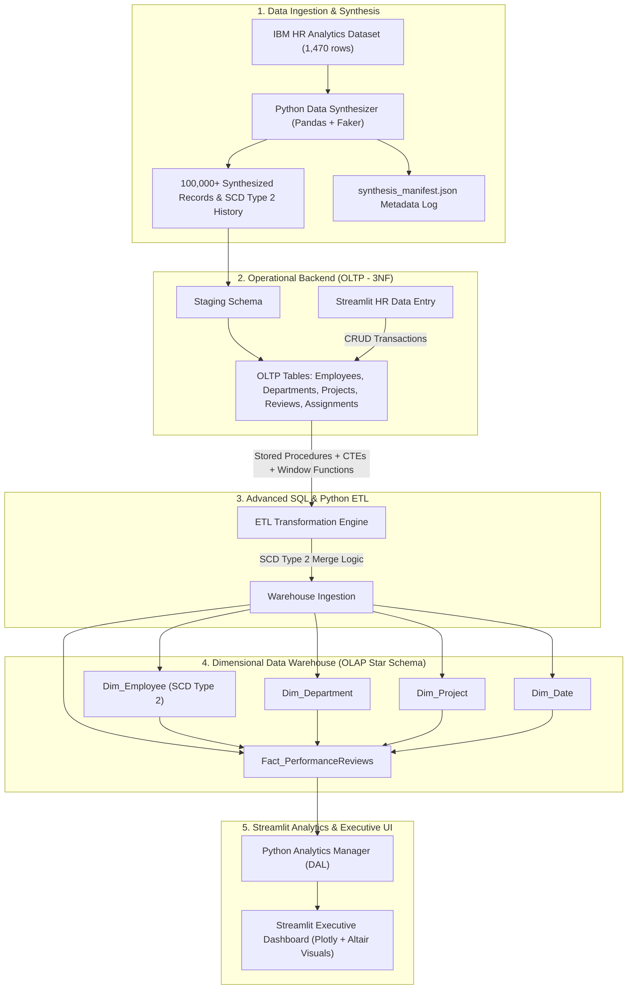

# Enterprise Employee Analytics & Data Warehouse System

An end-to-end, enterprise-grade Data Warehousing and Analytics solution engineered to migrate legacy, disconnected HR records into a centralized, cloud-ready dimensional data warehouse. The system couples an Object-Oriented Python backend with an interactive Streamlit web application to manage operational transactions (OLTP), maintain historical career trajectories using **Slowly Changing Dimensions (SCD Type 2)**, and deliver real-time executive analytics via an **OLAP Star Schema**.

---

## 📋 Table of Contents
1. [Project Overview & Problem Statement](#-project-overview--problem-statement)
2. [Technology Stack](#-technology-stack)
3. [System Architecture](#-system-architecture)
4. [Phased Implementation Roadmap](#-phased-implementation-roadmap)
   - [Phase 1: Architecture, Modeling, and Data Ingestion](#phase-1-architecture-modeling-and-data-ingestion)
   - [Phase 2: Advanced SQL & ETL Pipeline Development](#phase-2-advanced-sql--etl-pipeline-development)
   - [Phase 3: Python Application Logic (OOP Backend)](#phase-3-python-application-logic-oop-backend)
   - [Phase 4: Streamlit UI & Interactive Dashboards](#phase-4-streamlit-ui--interactive-dashboards)
   - [Phase 5: Version Control, Cloud Deployment & Documentation](#phase-5-version-control-cloud-deployment--documentation)
5. [Repository Structure](#-repository-structure)
6. [Git Branching Strategy & Pull Request History](#-git-branching-strategy--pull-request-history)
7. [Cloud Deployment to Streamlit Community Cloud](#-cloud-deployment-to-streamlit-community-cloud)
8. [Key Deliverables & Desired Outputs](#-key-deliverables--desired-outputs)
9. [Execution Plan & Verification](#-execution-plan--verification)

---

## 🏢 Project Overview & Problem Statement

Modern enterprise HR and executive leadership require granular visibility into employee performance, attrition indicators, project allocations, and organizational mobility. Legacy systems typically store flat or fragmented operational snapshots, making it impossible to perform longitudinal analyses—such as evaluating how an employee's performance rating shifts following a departmental transfer or salary adjustment.

This project delivers a complete enterprise solution:
- **Operational Data Store (OLTP):** A 3NF-normalized relational schema in MySQL to manage day-to-day employee onboarding, project assignments, and performance reviews.
- **Data Synthesizer (100,000+ Records):** A high-performance Python data generator utilizing the IBM HR Analytics dataset and `Faker` to generate synthetic enterprise history, SCD Type 2 records, and a verifiable `synthesis_manifest.json`.
- **Dimensional Data Warehouse (OLAP):** A Star Schema with surrogate keys, dedicated dimension tables, and an SCD Type 2 `Dim_Employee` tracking temporal changes (`start_date`, `end_date`, `is_current`).
- **Automated ETL & Stored Procedures:** Advanced SQL routines using Common Table Expressions (CTEs), Window Functions (`DENSE_RANK()`, `ROW_NUMBER()`), and transactional stored procedures.
- **Object-Oriented Python Backend:** Robust application layer adhering to SOLID principles, Singleton database connection pooling, SQLAlchemy Engine caching, custom exception hierarchy (`DatabaseError`, `ValidationError`), centralized logging, and a structured Data Access Layer (DAL).
- **Streamlit Web Application:** Interactive dual-mode frontend for HR operational entry, real-time SCD Type 2 triggers, Plotly performance intelligence, and an **Altair-powered Project Allocation & Bottleneck Analysis** engine.

---

## 🛠 Technology Stack

| Domain | Technology / Tool | Purpose |
| :--- | :--- | :--- |
| **Programming Language** | Python 3.10+ | Core OOP backend, ETL automation, data synthesis |
| **Libraries & Frameworks** | `pandas`, `numpy`, `Faker` | Data synthesis, scaling to 100K+ rows, historical scenario injection |
| **Relational Database (OLTP)** | MySQL 8.0 / MySQL Workbench | Operational transaction handling (3NF normalized schema) |
| **Data Warehouse (OLAP)** | MySQL 8.0 (Star Schema) | Analytical storage, surrogate keys, SCD Type 2 dimension tables |
| **Database Connectivity & ORM**| `pymysql`, `mysql-connector-python`, `SQLAlchemy` | Connection pooling, SQLAlchemy Engine caching (`get_sqlalchemy_engine()`) |
| **Web UI & Visualization** | Streamlit, Plotly, Altair | Operational input forms, real-time KPI metrics, interactive Plotly charts, Altair bottleneck diagrams |
| **Data Modeling Tools** | Draw.io (XML/SVG), Mermaid.js | Editable ER Diagrams (OLTP) and Dimensional Models (OLAP) |
| **Version Control & CI/CD** | Git, GitHub, GitHub Actions | Feature branching (`feature/*`), PR workflows, automated unit test CI pipeline (`.github/workflows/ci.yml`) |
| **Deployment Platform** | Streamlit Community Cloud | Cloud hosting for executive access with zero-configuration SQLite fallback |

---

## 🏗 System Architecture



---

## 🗺 Phased Implementation Roadmap

### Phase 1: Architecture, Modeling, and Data Ingestion
- **Objective:** Establish the foundational data models and generate high-fidelity, scaled synthetic data.
- **Key Tasks:**
  1. **Dataset Ingestion & Base Profiling:** Ingest the IBM HR Employee Attrition & Performance dataset (approx. 1,470 records) as the seed distribution.
  2. **Data Synthesizer (100,000+ records):** Implement `scripts/data_synthesizer.py` utilizing `pandas` and `Faker` to scale records up to 100,000+ rows while preserving statistical integrity. Generates `data/synthesized/synthesis_manifest.json` auditing exact parameters.
  3. **Historical SCD Type 2 Engineering:** Synthesize historical change timelines for 25% of employees with explicit timestamps (`effective_from`, `effective_to`, `is_current`, `version`).
  4. **OLTP Relational Modeling (ER Diagram):** Design a normalized (3NF) relational database schema for operational entities: `employees`, `departments`, `projects`, `performance_reviews`, and `employee_project_assignments`.
  5. **OLAP Dimensional Modeling (Star Schema):** Design a Star Schema featuring `Dim_Employee` (SCD Type 2), `Dim_Department`, `Dim_Project`, `Dim_Date`, and `Fact_PerformanceReviews`.
  6. **Diagram Deliverables:** Create editable `.drawio` XML files and high-resolution export files for both ERD and Dimensional Model.

### Phase 2: Advanced SQL & ETL Pipeline Development
- **Objective:** Provision databases and implement high-performance SQL transformations to feed the warehouse.
- **Key Tasks:**
  1. **DDL Creation:** Write modular, production-ready `.sql` scripts for OLTP tables, staging tables, and OLAP star schema dimensions and fact tables (`sql/ddl/01_oltp_schema.sql`, `sql/ddl/02_olap_star_schema.sql`).
  2. **Stored Procedures for ETL:**
     - `sp_etl_sync_dimensions`: Loads and synchronizes `Dim_Department`, `Dim_Project`, `Dim_Date`.
     - `sp_etl_scd2_employee`: Ingests staged employee updates; expires previous records (`end_date = CURRENT_DATE`, `is_current = FALSE`) and inserts new active records (`start_date = CURRENT_DATE`, `end_date = NULL`, `is_current = TRUE`).
     - `sp_etl_load_fact_performance`: Populates `Fact_PerformanceReviews` mapping natural keys to dimensional surrogate keys.
     - `sp_run_full_etl`: Master orchestrator.
  3. **Advanced SQL Transformations:**
     - Utilize **Common Table Expressions (CTEs)** to deduplicate and standardize staging data.
     - Implement **Window Functions** (`ROW_NUMBER() OVER (...)`, `LAG()` to track prior salaries/roles, and `DENSE_RANK()` for department performance percentiles) in `sql/queries/04_advanced_analytics.sql`.

### Phase 3: Python Application Logic (OOP Backend)
- **Objective:** Construct a decoupled, maintainable Object-Oriented software architecture.
- **Key Tasks:**
  1. **Database Manager (`src/database/db_manager.py`):**
     - Thread-safe `DatabaseConnection` class using the **Singleton Design Pattern**.
     - Connection context management, auto-reconnect, and **SQLAlchemy Engine caching** (`get_sqlalchemy_engine()`).
     - Seamless fallback to SQLite warehouse for cloud deployments with auto-provisioning.
  2. **Domain Entities (`src/entities/`):**
     - `Employee`: Encapsulates attributes, annual compensation calculation, and validation logic.
     - `Project`: Encapsulates project timeline, budget, status, and assignment logic.
     - `PerformanceReview`: Encapsulates ratings, metrics, and score validation.
  3. **Data Access Layer / Managers (`src/managers/`):**
     - `EmployeeManager`: CRUD operations, employee search, department reassignments triggering SCD Type 2 updates.
     - `ProjectManager`: Project creation, team allocation, budget tracking, review submission.
     - `AnalyticsManager`: Interfaces with OLAP Star Schema to execute optimized analytical queries, DENSE_RANK leaderboards, and Project Allocation & Bottleneck diagnostics.
  4. **Exception Handling & Centralized Logging:**
     - Custom exception hierarchy (`src/exceptions.py`): `DatabaseError`, `ValidationError`, `EntityNotFoundError`, `ETLError`.
     - Centralized logging framework (`src/logger.py`) with configurable levels.

### Phase 4: Streamlit UI & Interactive Dashboards
- **Objective:** Provide an intuitive dual-purpose web portal for HR operations and C-suite analytics.
- **Key Tasks:**
  1. **Operational HR Portal (`pages/1_HR_Operations.py`):**
     - Employee Onboarding Form: Add new employees with automated role and department assignments.
     - Project Management Module: Assign employees to active initiatives and track workload allocation.
     - Career & Role Update Workflow: Change an employee's department, title, or compensation directly via the UI; immediately dispatches transactional updates and propagates SCD Type 2 records in the warehouse.
  2. **Executive Analytics Dashboard (`pages/2_Executive_Analytics.py`):**
     - **Year-over-Year (YoY) Performance Trends:** Longitudinal tracking of performance scores across departments.
     - **Top Performers by Department:** Filterable leaderboards powered by SQL `DENSE_RANK()`.
     - **Attrition Risk Matrix:** Correlation analysis linking attrition flags with overtime, tenure, salary hikes, and work-life balance scores.
     - **Project Allocation & Bottleneck Analysis:** Interactive Altair chart comparing active initiatives vs allocated FTEs across departments to flag under- or over-resourced teams.
     - **SCD Type 2 Career Mobility Audit:** Multi-version career history table.

### Phase 5: Version Control, Cloud Deployment & Documentation
- **Objective:** Ensure production readiness, cloud deployment, and comprehensive documentation.
- **Key Tasks:**
  1. **Git Workflow & CI/CD:**
     - Feature branches merged into `main`: `feature/database-design`, `feature/sql-etl-procedures`, `feature/python-oop-backend`, `feature/streamlit-dashboard`.
     - Standardized Pull Request template (`.github/pull_request_template.md`).
     - Automated GitHub Actions CI pipeline (`.github/workflows/ci.yml`).
  2. **Cloud Readiness & Configuration:**
     - Streamlit settings in `.streamlit/config.toml`.
     - Secrets template in `.streamlit/secrets.toml.example`.
     - Environment template in `.env.example`.
     - Complete step-by-step cloud deployment manual in `docs/DEPLOYMENT_GUIDE.md`.
  3. **Documentation Deliverables:**
     - Architecture & SCD2 Guide: `docs/ARCHITECTURE_GUIDE.md`.
     - Data Dictionary & Schema Specification: `docs/DATA_DICTIONARY.md`.
     - Cloud Deployment Guide: `docs/DEPLOYMENT_GUIDE.md`.

---

## 📂 Repository Structure

```text
Enterprise-Employee-Analytics/
│
├── .github/
│   ├── workflows/
│   │   └── ci.yml                   # GitHub Actions automated test runner
│   └── pull_request_template.md     # Standardized Pull Request template
│
├── .streamlit/
│   ├── config.toml                  # Streamlit visual theme and server configuration
│   └── secrets.toml.example         # Template for cloud database credentials
│
├── data/
│   ├── raw/
│   │   └── WA_Fn-UseC_-HR-Employee-Attrition.csv # IBM HR seed dataset
│   └── synthesized/                 # Generated 100,000+ row dataset & SCD2 logs
│       ├── departments.csv
│       ├── employees_oltp_current.csv
│       ├── employees_scd2_full.csv
│       ├── projects.csv
│       ├── project_assignments.csv
│       ├── performance_reviews.csv
│       └── synthesis_manifest.json  # Data synthesis configuration & record count manifest
│
├── docs/
│   ├── diagrams/                    # Editable Draw.io files (.drawio) & image exports
│   │   ├── oltp_er_diagram.drawio
│   │   ├── oltp_er_diagram.png
│   │   ├── olap_star_schema.drawio
│   │   └── olap_star_schema.png
│   ├── ARCHITECTURE_GUIDE.md        # In-depth architectural & SCD2 documentation
│   ├── DATA_DICTIONARY.md           # Schema definitions and field descriptions
│   └── DEPLOYMENT_GUIDE.md          # Streamlit Community Cloud deployment instructions
│
├── sql/
│   ├── ddl/
│   │   ├── 01_oltp_schema.sql       # 3NF Operational tables & constraints
│   │   └── 02_olap_star_schema.sql  # Star Schema dimensions, facts, and bridge table
│   ├── etl/
│   │   └── 03_stored_procedures.sql # Stored procedures for ETL & SCD2 synchronization
│   └── queries/
│       └── 04_advanced_analytics.sql# CTEs, Window functions (DENSE_RANK, LAG, ROW_NUMBER)
│
├── src/
│   ├── database/
│   │   ├── __init__.py
│   │   └── db_manager.py            # Singleton DB manager + SQLAlchemy Engine integration
│   ├── entities/
│   │   ├── __init__.py
│   │   ├── employee.py              # Employee domain entity & validations
│   │   ├── project.py               # Project domain entity & budget tiers
│   │   └── review.py                # PerformanceReview entity & attrition scoring
│   ├── managers/
│   │   ├── __init__.py
│   │   ├── base_manager.py          # Abstract DAL base with query execution
│   │   ├── employee_manager.py      # Employee CRUD & SCD Type 2 reassignment
│   │   ├── project_manager.py       # Project initiatives, staffing, review submission
│   │   └── analytics_manager.py     # OLAP analytics, DENSE_RANK, bottleneck analysis
│   ├── exceptions.py                # Custom exception hierarchy (DatabaseError, ValidationError)
│   └── logger.py                    # Centralized structured logging configuration
│
├── scripts/
│   ├── data_synthesizer.py          # Scales base dataset to 100K+ rows with SCD2
│   ├── demo_employee_manager.py     # Sanity check script for OOP backend
│   ├── export_diagrams.py           # Exports Draw.io diagrams to high-res images
│   └── run_etl.py                   # Python ETL runner executing stored procedures / SQLite
│
├── pages/
│   ├── 1_HR_Operations.py           # Streamlit OLTP forms & live SCD2 triggers
│   └── 2_Executive_Analytics.py     # Streamlit OLAP dashboards (Plotly + Altair)
│
├── tests/
│   ├── __init__.py
│   ├── test_oop_backend.py          # OOP backend, Singleton, and SCD2 trigger tests
│   └── test_streamlit_pages.py      # Streamlit pages integration test
│
├── app.py                           # Main Streamlit application entry point
├── requirements.txt                 # Python dependencies
├── .env.example                     # Environment variables configuration template
├── .gitignore                       # Git ignore rules
└── README.md                        # Master project documentation
```

---

## 🌿 Git Branching Strategy & Pull Request History

To comply with enterprise engineering standards, the repository follows a structured feature branching workflow. Each core phase was developed in a dedicated feature branch and merged into `main`:

| PR / Branch | Source Branch | Target Branch | Primary Scope | Status |
| :--- | :--- | :--- | :--- | :--- |
| **PR #1** | `feature/database-design` | `main` | Phase 1: 3NF OLTP schema, OLAP Star Schema DDL, Draw.io ER diagrams | Merged |
| **PR #2** | `feature/sql-etl-procedures` | `main` | Phase 2: Stored procedures, SCD Type 2 merge routines, window function queries | Merged |
| **PR #3** | `feature/python-oop-backend` | `main` | Phase 3: Singleton DB manager, domain entities, DAL managers, custom exceptions | Merged |
| **PR #4** | `feature/streamlit-dashboard` | `main` | Phase 4: Streamlit multi-page app, live SCD2 form, Plotly & Altair analytics | Merged |

Standardized pull request submissions adhere to the checklist outlined in [`.github/pull_request_template.md`](.github/pull_request_template.md).

---

## ☁️ Cloud Deployment to Streamlit Community Cloud

The application is cloud-native and deployable in 1 click to **Streamlit Community Cloud**:
1. Connect your GitHub account to [share.streamlit.io](https://share.streamlit.io).
2. Point the deployment target to:
   - **Repository:** `Enterprise-Employee-Analytics-Data-Warehouse-System`
   - **Branch:** `main`
   - **Main file path:** `app.py`
3. If connecting to a cloud MySQL instance, populate the secrets in the Streamlit Cloud dashboard using `.streamlit/secrets.toml.example`. Otherwise, the system automatically runs serverless using the built-in SQLite warehouse.
4. For comprehensive configuration details, see [`docs/DEPLOYMENT_GUIDE.md`](docs/DEPLOYMENT_GUIDE.md).

---

## 🎯 Key Deliverables & Desired Outputs

| # | Deliverable | Format / Tool | Target Criteria |
| :--- | :--- | :--- | :--- |
| **1** | **Data Synthesizer** | Python (`pandas`, `Faker`) | Generates 100,000+ realistic records; injects SCD Type 2 historical change events; audits via `synthesis_manifest.json` |
| **2** | **Architecture Diagrams** | Draw.io (`.drawio`) & PNG | 1x OLTP ER Diagram (3NF), 1x OLAP Star Schema (Surrogate Keys, SCD2) |
| **3** | **Database SQL Scripts** | MySQL `.sql` scripts | DDL for OLTP/OLAP, Stored Procedures for SCD2 merge, CTEs & Window Functions |
| **4** | **OOP Application Core** | Modular Python 3 | Singleton DB connection, SQLAlchemy Engine support, domain entities, custom exceptions, robust DAL |
| **5** | **Streamlit Application** | Python (`streamlit`, `plotly`, `altair`) | Operational forms triggering SCD2, interactive executive analytics dashboard with Altair bottleneck visuals |
| **6** | **Documentation** | Markdown & Guides | Comprehensive setup guide, architecture walkthrough, deployment guide, and data dictionary |

---

## 🚀 Execution Plan & Verification

To verify the complete system locally:

```bash
# 1. Clone the repository and enter directory
git clone https://github.com/Pratikdesai4/Enterprise-Employee-Analytics-Data-Warehouse-System.git
cd Enterprise-Employee-Analytics-Data-Warehouse-System

# 2. Set up virtual environment and install dependencies
python -m venv venv
source venv/bin/activate  # On Windows: .\venv\Scripts\Activate.ps1
pip install -r requirements.txt

# 3. Run unit tests
python -m unittest discover -s tests -v

# 4. Run the OOP Backend verification script
python scripts/demo_employee_manager.py

# 5. Launch the Streamlit application
streamlit run app.py
```
