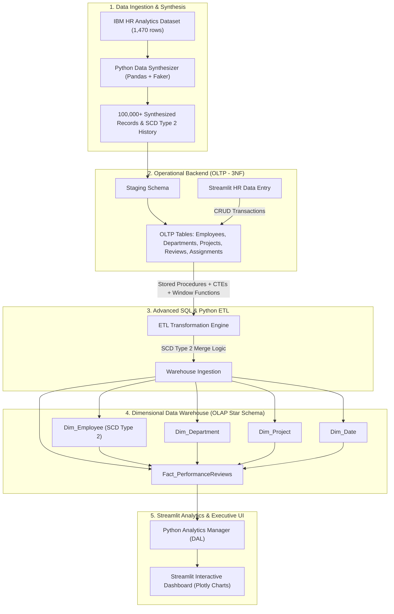

# Enterprise Employee Analytics & Data Warehouse System

An end-to-end, enterprise-grade Data Warehousing and Analytics solution engineered to migrate legacy, disconnected HR records into a centralized, cloud-ready dimensional data warehouse. The system couples an Object-Oriented Python backend with an interactive Streamlit web application to manage operational transactions (OLTP), maintain historical career trajectories using **Slowly Changing Dimensions (SCD Type 2)**, and deliver real-time executive analytics via an **OLAP Star Schema**.

---

## 📋 Table of Contents
1. [Project Overview & Problem Statement](#-project-overview--problem-statement)
2. [Technology Stack](#-technology-stack)
3. [System Architecture](#-system-architecture)
4. [Phased Implementation Roadmap](#-phased-implementation-roadmap)
   - [Phase 1: Architecture, Modeling, and Data Ingestion](#phase-1-architecture-modeling-and-data-ingestion)
   - [Phase 2: Advanced SQL & ETL Pipeline Development](#phase-2-advanced-sql--etl-pipeline-development)
   - [Phase 3: Python Application Logic (OOP Backend)](#phase-3-python-application-logic-oop-backend)
   - [Phase 4: Streamlit UI & Interactive Dashboards](#phase-4-streamlit-ui--interactive-dashboards)
   - [Phase 5: Version Control, Cloud Deployment & Documentation](#phase-5-version-control-cloud-deployment--documentation)
5. [Repository Structure](#-repository-structure)
6. [Key Deliverables & Desired Outputs](#-key-deliverables--desired-outputs)
7. [Execution Plan & Next Steps](#-execution-plan--next-steps)

---

## 🏢 Project Overview & Problem Statement

Modern enterprise HR and executive leadership require granular visibility into employee performance, attrition indicators, project allocations, and organizational mobility. Legacy systems typically store flat or fragmented operational snapshots, making it impossible to perform longitudinal analyses—such as evaluating how an employee's performance rating shifts following a departmental transfer or salary adjustment.

This project delivers a complete enterprise solution:
- **Operational Data Store (OLTP):** A 3NF-normalized relational schema in MySQL to manage day-to-day employee onboarding, project assignments, and performance reviews.
- **Data Synthesizer (100,000+ Records):** A high-performance Python data generator utilizing the IBM HR Analytics dataset and `Faker` to generate synthetic enterprise history and multi-version SCD Type 2 records.
- **Dimensional Data Warehouse (OLAP):** A Star Schema with surrogate keys, dedicated dimension tables, and an SCD Type 2 `Dim_Employee` tracking temporal changes (`start_date`, `end_date`, `is_current`).
- **Automated ETL & Stored Procedures:** Advanced SQL routines using Common Table Expressions (CTEs), Window Functions (`DENSE_RANK()`, `ROW_NUMBER()`), and transactional stored procedures.
- **Object-Oriented Python Backend:** Robust application layer adhering to SOLID principles, Singleton database connection pooling, domain entities, and a structured Data Access Layer (DAL).
- **Streamlit Web Application:** Interactive dual-mode frontend for HR operational entry and executive OLAP visual intelligence.

---

## 🛠 Technology Stack

| Domain | Technology / Tool | Purpose |
| :--- | :--- | :--- |
| **Programming Language** | Python 3.10+ | Core OOP backend, ETL automation, data synthesis |
| **Libraries & Frameworks** | `pandas`, `numpy`, `Faker` | Data synthesis, scaling to 100K+ rows, historical scenario injection |
| **Relational Database (OLTP)** | MySQL 8.0 / MySQL Workbench | Operational transaction handling (3NF normalized schema) |
| **Data Warehouse (OLAP)** | MySQL 8.0 (Star Schema) | Analytical storage, surrogate keys, SCD Type 2 dimension tables |
| **Database Connectivity** | `mysql-connector-python`, `SQLAlchemy` | Connection pooling, ORM/DAL integration |
| **Web UI & Visualization** | Streamlit, Plotly, Altair | Operational input forms, real-time KPI metrics, interactive charts |
| **Data Modeling Tools** | Draw.io (XML/SVG), Mermaid.js | Editable ER Diagrams (OLTP) and Dimensional Models (OLAP) |
| **Version Control & CI/CD** | Git, GitHub | Feature branching (`feature/*`), code reviews, release workflows |
| **Deployment Platform** | Streamlit Community Cloud | Cloud hosting for executive access |

---

## 🏗 System Architecture



---

## 🗺 Phased Implementation Roadmap

### Phase 1: Architecture, Modeling, and Data Ingestion
- **Objective:** Establish the foundational data models and generate high-fidelity, scaled synthetic data.
- **Key Tasks:**
  1. **Dataset Ingestion & Base Profiling:** Ingest the IBM HR Employee Attrition & Performance dataset (approx. 1,470 records) as the seed distribution.
  2. **Data Synthesizer (100,000+ records):** Implement `scripts/data_synthesizer.py` utilizing `pandas` and `Faker` to scale records up to 100,000+ rows while preserving statistical integrity (salary distributions, attrition factors, age-to-experience correlations).
  3. **Historical SCD Type 2 Engineering:** Synthesize historical change timelines for a subset of employees (department transfers, role promotions, salary raises, manager changes) with explicit timestamps (`effective_from`, `effective_to`, `is_current`).
  4. **OLTP Relational Modeling (ER Diagram):** Design a normalized (3NF) relational database schema for operational entities: `Employees`, `Departments`, `Projects`, `PerformanceReviews`, and `EmployeeProjectAssignments`.
  5. **OLAP Dimensional Modeling (Star Schema):** Design a Star Schema featuring:
     - `Dim_Employee` (Surrogate Key `employee_dim_id`, Business Key `employee_id`, SCD Type 2 fields: `start_date`, `end_date`, `is_current`).
     - `Dim_Department`, `Dim_Project`, `Dim_Date` (Surrogate Keys).
     - `Fact_PerformanceReviews` (Metrics: review rating, work-life balance, satisfaction scores, salary at review, promotion indicator).
  6. **Diagram Deliverables:** Create editable `.drawio` XML files and high-resolution export files for both ERD and Dimensional Model.
- **Desired Output:**
  - `data/raw/` and `data/synthesized/` holding generated datasets.
  - `docs/diagrams/oltp_er_diagram.drawio` and `docs/diagrams/olap_star_schema.drawio`.
  - Data profile summary confirming 100,000+ records and historical SCD Type 2 distributions.

---

### Phase 2: Advanced SQL & ETL Pipeline Development
- **Objective:** Provision databases and implement high-performance SQL transformations to feed the warehouse.
- **Key Tasks:**
  1. **DDL Creation:** Write modular, production-ready `.sql` scripts for OLTP tables, staging tables, and OLAP star schema dimensions and fact tables.
  2. **Stored Procedures for ETL:**
     - `sp_etl_sync_dimensions`: Loads and synchronizes `Dim_Department`, `Dim_Project`, `Dim_Date`.
     - `sp_etl_scd2_employee`: Ingests staged employee updates; expires previous records (`end_date = CURRENT_DATE`, `is_current = FALSE`) and inserts new active records (`start_date = CURRENT_DATE`, `end_date = NULL`, `is_current = TRUE`).
     - `sp_etl_load_fact_performance`: Populates `Fact_PerformanceReviews` mapping natural keys to dimensional surrogate keys.
  3. **Advanced SQL Transformations:**
     - Utilize **Common Table Expressions (CTEs)** to deduplicate and standardize staging data.
     - Implement **Window Functions** (`ROW_NUMBER() OVER (...)`, `LAG()` to track prior salaries/roles, and `DENSE_RANK()` for department performance percentiles).
- **Desired Output:**
  - `sql/ddl/01_create_oltp_schema.sql`
  - `sql/ddl/02_create_olap_schema.sql`
  - `sql/etl/03_stored_procedures_etl.sql`
  - `sql/queries/04_advanced_analytics_window_functions.sql`

---

### Phase 3: Python Application Logic (OOP Backend)
- **Objective:** Construct a decoupled, maintainable Object-Oriented software architecture.
- **Key Tasks:**
  1. **Database Manager (`src/database/db_manager.py`):**
     - Implement a thread-safe `DatabaseConnection` class using the **Singleton Design Pattern**.
     - Support connection pooling, auto-reconnect, and context-managed transactions (`with db.get_cursor()`).
  2. **Domain Entities (`src/entities/`):**
     - `Employee`: Encapsulates attributes (ID, name, role, salary, department) and validation logic.
     - `Project`: Encapsulates project timeline, budget, status, and assignment logic.
     - `PerformanceReview`: Encapsulates ratings, metrics, and score validation.
  3. **Data Access Layer / Managers (`src/managers/`):**
     - `EmployeeManager`: CRUD operations, employee search, department reassignments triggering SCD Type 2 updates.
     - `ProjectManager`: Project creation, team allocation, budget tracking.
     - `AnalyticsManager`: Interfaces with OLAP Star Schema to execute optimized analytical queries and return typed data structures / pandas DataFrames for Streamlit rendering.
  4. **Exception Handling & Logging:** Centralized logging and custom application exceptions (`DatabaseError`, `ValidationError`).
- **Desired Output:**
  - Fully tested OOP Python modules with clean separation of concerns and type hinting.

---

### Phase 4: Streamlit UI & Interactive Dashboards
- **Objective:** Provide an intuitive dual-purpose web portal for HR operations and C-suite analytics.
- **Key Tasks:**
  1. **Operational HR Portal (OLTP Interaction):**
     - Employee Onboarding Form: Add new employees with automated role and department assignments.
     - Project Management Module: Assign employees to active initiatives and track workload allocation.
     - Career & Role Update Workflow: Change an employee's department, title, or compensation directly via the UI; immediately dispatches transactional updates and propagates SCD Type 2 records in the warehouse.
  2. **Executive Analytics Dashboard (OLAP Star Schema):**
     - **Year-over-Year (YoY) Performance Trends:** Longitudinal tracking of performance scores across departments.
     - **Top Performers by Department:** Filterable leaderboards powered by `DENSE_RANK()`.
     - **Attrition Risk Matrix:** Correlation analysis linking attrition flags with overtime, tenure, salary hikes, and work-life balance scores.
     - **Project Allocation & Bottleneck Analysis:** Workload distribution visuals identifying under-resourced or bottlenecked departments.
- **Desired Output:**
  - Modern Streamlit application (`app.py` with multi-page structure: `pages/1_HR_Operations.py`, `pages/2_Executive_Analytics.py`).
  - Interactive charts rendered via Plotly with real-time filters (Department, Year, Role, Performance Tier).

---

### Phase 5: Version Control, Cloud Deployment & Documentation
- **Objective:** Ensure production readiness, cloud deployment, and comprehensive documentation.
- **Key Tasks:**
  1. **Git Workflow:** Establish Git repository with structured feature branching:
     - `feature/data-synthesis-and-modeling`
     - `feature/sql-etl-procedures`
     - `feature/python-oop-backend`
     - `feature/streamlit-dashboard`
     - Merge into `main` via documented pull requests.
  2. **Cloud Readiness & Configuration:** Create `.streamlit/config.toml`, `requirements.txt`, and environment variables handling (`.env.example` and `st.secrets`).
  3. **Project Documentation:** Complete architectural guide, database dictionary, setup instructions, and Google Doc export covering design rationales and performance benchmarks.
- **Desired Output:**
  - Clean GitHub commit history and merged branches.
  - Cloud-ready configuration files.
  - Comprehensive `README.md` and `docs/ARCHITECTURE_GUIDE.md`.

---

## 📂 Repository Structure

```text
Enterprise-Employee-Analytics/
│
├── .streamlit/
│   └── config.toml                  # Streamlit visual theme and server settings
├── data/
│   ├── raw/                         # Base IBM HR Analytics seed dataset
│   └── synthesized/                 # Generated 100,000+ row dataset & SCD2 logs
│
├── docs/
│   ├── diagrams/                    # Editable Draw.io files (.drawio) & image exports
│   │   ├── oltp_er_diagram.drawio
│   │   └── olap_star_schema.drawio
│   ├── ARCHITECTURE_GUIDE.md        # In-depth architectural & SCD2 documentation
│   └── DATA_DICTIONARY.md           # Schema definitions and field descriptions
│
├── sql/
│   ├── ddl/
│   │   ├── 01_oltp_schema.sql       # 3NF Operational tables & constraints
│   │   └── 02_olap_star_schema.sql  # Star Schema dimensions and facts
│   ├── etl/
│   │   └── 03_stored_procedures.sql # Stored procedures for ETL & SCD2 synchronization
│   └── queries/
│       └── 04_analytical_queries.sql# CTEs, Window functions, and KPI views
│
├── src/
│   ├── database/
│   │   ├── __init__.py
│   │   └── db_manager.py            # Singleton database connection & pool manager
│   ├── entities/
│   │   ├── __init__.py
│   │   ├── employee.py              # Employee entity class
│   │   ├── project.py               # Project entity class
│   │   └── review.py                # PerformanceReview entity class
│   └── managers/
│       ├── __init__.py
│       ├── employee_manager.py      # Employee CRUD & department reassignment
│       ├── project_manager.py       # Project operations & allocations
│       └── analytics_manager.py     # OLAP query execution & KPI aggregations
│
├── scripts/
│   ├── data_synthesizer.py          # Scales base dataset to 100K+ rows with SCD2
│   └── run_etl.py                   # Python ETL runner executing stored procedures
│
├── pages/
│   ├── 1_HR_Operations.py           # Streamlit OLTP forms & data entry
│   └── 2_Executive_Analytics.py     # Streamlit OLAP dashboards & Plotly visuals
│
├── app.py                           # Main Streamlit application entry point
├── requirements.txt                 # Python dependencies
├── .gitignore                       # Git ignore rules
└── README.md                        # Master project documentation & execution plan
```

---

## 🎯 Key Deliverables & Desired Outputs

| # | Deliverable | Format / Tool | Target Criteria |
| :--- | :--- | :--- | :--- |
| **1** | **Data Synthesizer** | Python (`pandas`, `Faker`) | Generates 100,000+ realistic records; injects SCD Type 2 historical change events |
| **2** | **Architecture Diagrams** | Draw.io (`.drawio`) & SVG/PNG | 1x OLTP ER Diagram (3NF), 1x OLAP Star Schema (Surrogate Keys, SCD2) |
| **3** | **Database SQL Scripts** | MySQL `.sql` scripts | DDL for OLTP/OLAP, Stored Procedures for SCD2 merge, CTEs & Window Functions |
| **4** | **OOP Application Core** | Modular Python 3 | Singleton DB connection, domain entities, robust Data Access Layer |
| **5** | **Streamlit Application** | Python (`streamlit`, `plotly`) | Operational forms triggering SCD2, interactive executive analytics dashboard |
| **6** | **Documentation** | Markdown & Google Doc | Comprehensive setup guide, architecture walkthrough, and benchmark results |

---

## 🚀 Execution Plan & Next Steps

We will proceed through execution in structured, verifiable stages:

1. **Phase 1 (Immediate Next Step):**
   - Download/synthesize the seed IBM HR Analytics dataset.
   - Implement `scripts/data_synthesizer.py` to scale data to 100,000+ rows and generate SCD Type 2 history.
   - Author editable XML `.drawio` files for both the OLTP ER Diagram and OLAP Star Schema.
2. **Phase 2:** Author and execute complete SQL scripts (DDL, Stored Procedures, CTEs, Window Functions).
3. **Phase 3:** Develop the OOP backend classes (`db_manager.py`, entity classes, and manager classes).
4. **Phase 4:** Build the Streamlit web application with operational forms and analytics dashboards.
5. **Phase 5:** Finalize documentation, configure cloud deployment assets, and prepare Git version control.
