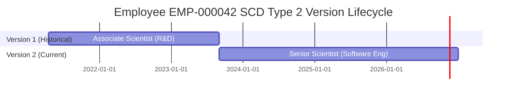

# Enterprise Employee Analytics - Architecture & SCD Type 2 Technical Guide

## 1. Executive Summary

This architecture establishes a high-throughput, cloud-ready enterprise data platform that bridges operational transactional systems (OLTP) with an analytical dimensional data warehouse (OLAP). The platform solves the limitation of legacy HR systems, which store static employee snapshots and lose the context of career trajectories, departmental transfers, and compensation changes.

---

## 2. Slowly Changing Dimensions (SCD Type 2) Mechanics

### Why SCD Type 2?
In standard operational databases, an employee's record is updated in place (`UPDATE employees SET department_id = 2 WHERE employee_id = 'EMP-000001'`). When this occurs, historical context is erased:
- Queries evaluating past performance within their former department falsely assign metrics to the new department.
- Historical salary reviews become disjointed from historical inflation and role expectations.

**SCD Type 2 preserves the full history** by creating a new version of the dimension row whenever a tracked attribute changes.

### Attribute Tracking Matrix
In `Dim_Employee`, the following tracked attributes trigger a new SCD Type 2 record version:
1. `department_name` / `department_id`
2. `job_role`
3. `monthly_income` (salary adjustments exceeding baseline merit bands)

Non-tracked attributes (such as typographical corrections in `first_name` or `phone`) are handled as SCD Type 1 (in-place update).

### Temporal Lifecycle Diagram



### Warehouse State Representation
| employee_dim_id | employee_id | job_role | department_name | monthly_income | start_date | end_date | is_current | version |
| :---: | :---: | :--- | :--- | :---: | :---: | :---: | :---: | :---: |
| **1042** | `EMP-000042` | Associate Scientist | Research & Development | \$5,400.00 | `2021-04-15` | `2023-09-01` | **0** | **1** |
| **1043** | `EMP-000042` | Senior Scientist | Software Engineering | \$9,800.00 | `2023-09-01` | `NULL` | **1** | **2** |

### ETL Ingestion Logic for SCD Type 2
When the ETL pipeline detects a delta between OLTP `employees` and the current active record in `Dim_Employee`:
1. **Expire Active Version:**
   ```sql
   UPDATE Dim_Employee
   SET end_date = CURRENT_DATE,
       is_current = 0
   WHERE employee_id = :employee_id
     AND is_current = 1;
   ```
2. **Insert Successor Version:**
   ```sql
   INSERT INTO Dim_Employee (
       employee_id, first_name, last_name, gender, age, hire_date,
       department_name, job_role, education_field, monthly_income,
       start_date, end_date, is_current, version
   )
   VALUES (
       :employee_id, :first_name, :last_name, :gender, :age, :hire_date,
       :department_name, :job_role, :education_field, :monthly_income,
       CURRENT_DATE, NULL, 1, :prior_version + 1
   );
   ```
3. **Fact Table Integrity:**
   - Any historical review conducted in 2022 joins to `employee_dim_id = 1042` (Version 1).
   - Any review conducted in 2024 joins to `employee_dim_id = 1043` (Version 2).
   - Reports accurately reflect the employee's performance in both roles without retroactive contamination.

---

## 3. Surrogate Key Design

All OLAP dimensions implement warehouse-generated **Surrogate Keys** (`BIGINT` or `INT` primary keys) separate from operational Business Keys (`employee_id`, `project_id`):
1. **Source System Decoupling:** Operational system renumbering or consolidation does not break the warehouse data model.
2. **SCD Type 2 Enablement:** Natural keys are non-unique across multiple historical versions; surrogate keys guarantee primary key uniqueness.
3. **Query Performance:** Integer surrogate keys allow compact foreign key indexes in billion-row fact tables.
4. **Smart Date Keys:** `Dim_Date` uses integer keys formatted as `YYYYMMDD` (e.g. `20251215`), allowing date filtering without function calls.

---

## 4. Phase 1 Verification Checklist

| Criterion | Target | Actual Verified Result | Status |
| :--- | :--- | :--- | :---: |
| **Base Dataset Sourced** | IBM HR Dataset (~1,470 rows) | 1,470 rows, 35 columns downloaded | ✅ PASSED |
| **Volume Scaling** | 100,000+ rows generated | 100,000 active employees generated | ✅ PASSED |
| **SCD Type 2 Engineering** | Multi-version historical rows | 125,000 total SCD2 records (25,000 expired V1 + 100,000 active) | ✅ PASSED |
| **Longitudinal Facts** | Longitudinal performance reviews | 183,146 performance review records | ✅ PASSED |
| **Project Assignments** | Relational allocations | 39,880 assignments across 60 projects | ✅ PASSED |
| **OLTP ER Diagram** | Editable diagram (3NF) | `docs/diagrams/oltp_er_diagram.drawio` created | ✅ PASSED |
| **OLAP Star Schema** | Editable dimensional model | `docs/diagrams/olap_star_schema.drawio` created | ✅ PASSED |
| **Documentation** | Data Dictionary & Architecture | `docs/DATA_DICTIONARY.md` & `ARCHITECTURE_GUIDE.md` | ✅ PASSED |
