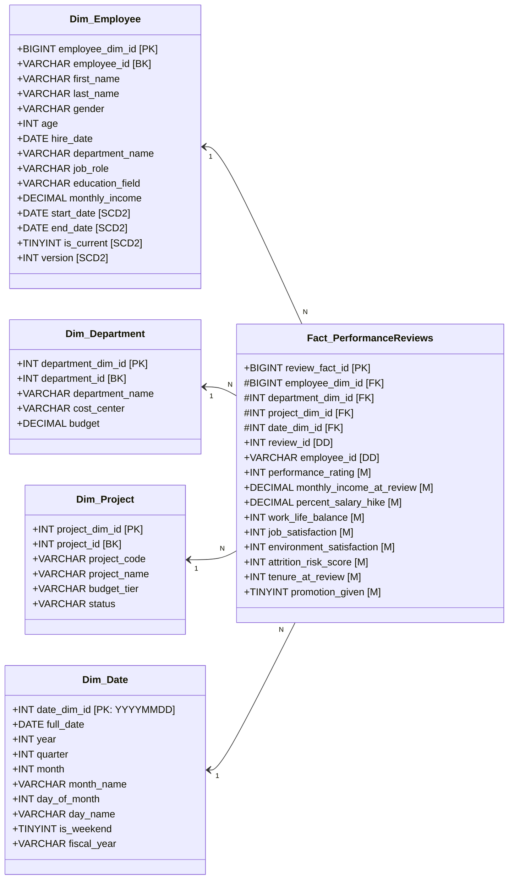

# Enterprise Employee Analytics - Data Dictionary & Schema Specification

This document provides complete data dictionary specifications for both the **OLTP Relational Backend** and the **OLAP Dimensional Data Warehouse**.

---

## 1. OLTP Relational Database Schema (3NF)

Designed for ACID-compliant operational data processing, employee onboarding, assignment allocations, and review submissions.

### Table: `departments`
Stores enterprise organizational units and cost centers.

| Column | Type | Constraints | Description |
| :--- | :--- | :--- | :--- |
| `department_id` | `INT` | PRIMARY KEY, AUTO_INCREMENT | Unique identifier for department |
| `department_name`| `VARCHAR(100)` | NOT NULL, UNIQUE | Functional name (e.g., Software Engineering) |
| `cost_center` | `VARCHAR(20)` | NOT NULL, UNIQUE | Financial cost center code (e.g., CC-SWE-404) |
| `budget` | `DECIMAL(15,2)`| NOT NULL | Annual operating budget allocated to department |

### Table: `employees`
Stores operational state of current employees.

| Column | Type | Constraints | Description |
| :--- | :--- | :--- | :--- |
| `employee_id` | `VARCHAR(20)` | PRIMARY KEY | Unique business identifier (e.g., EMP-000001) |
| `first_name` | `VARCHAR(50)` | NOT NULL | Employee given name |
| `last_name` | `VARCHAR(50)` | NOT NULL | Employee family name |
| `email` | `VARCHAR(100)` | NOT NULL, UNIQUE | Corporate email address |
| `phone` | `VARCHAR(30)` | NOT NULL | Contact telephone number |
| `gender` | `VARCHAR(10)` | NOT NULL | Gender identity |
| `age` | `INT` | NOT NULL | Current chronological age |
| `marital_status`| `VARCHAR(20)` | NOT NULL | Marital status (Single, Married, Divorced) |
| `hire_date` | `DATE` | NOT NULL | Date employee joined the company |
| `department_id` | `INT` | NOT NULL, FK -> `departments` | Assigned departmental unit |
| `job_role` | `VARCHAR(100)` | NOT NULL | Operational job role / title |
| `education_field`| `VARCHAR(100)`| NOT NULL | Academic field of study |
| `monthly_income`| `DECIMAL(12,2)`| NOT NULL | Current monthly base salary (USD) |
| `overtime` | `VARCHAR(5)` | NOT NULL | Overtime eligibility/status ('Yes', 'No') |
| `years_at_company`| `INT` | NOT NULL | Total tenure at company in years |
| `attrition` | `VARCHAR(5)` | NOT NULL | Attrition status ('Yes' if departed, else 'No') |
| `status` | `VARCHAR(20)` | NOT NULL | 'Active', 'On Leave', 'Terminated' |

### Table: `projects`
Tracks initiatives, timelines, and budgets across departments.

| Column | Type | Constraints | Description |
| :--- | :--- | :--- | :--- |
| `project_id` | `INT` | PRIMARY KEY, AUTO_INCREMENT | Internal project ID |
| `project_code` | `VARCHAR(20)` | NOT NULL, UNIQUE | Business project code (e.g., PRJ-0001) |
| `project_name` | `VARCHAR(150)` | NOT NULL | Descriptive initiative title |
| `department_id` | `INT` | NOT NULL, FK -> `departments` | Sponsoring department |
| `start_date` | `DATE` | NOT NULL | Scheduled start date |
| `end_date` | `DATE` | NOT NULL | Projected or actual completion date |
| `budget` | `DECIMAL(15,2)`| NOT NULL | Financial budget in USD |
| `status` | `VARCHAR(30)` | NOT NULL | 'Planning', 'In Progress', 'Completed', 'On Hold' |

### Table: `employee_project_assignments`
Bridge table managing employee allocations and project roles.

| Column | Type | Constraints | Description |
| :--- | :--- | :--- | :--- |
| `assignment_id` | `INT` | PRIMARY KEY, AUTO_INCREMENT | Assignment record ID |
| `employee_id` | `VARCHAR(20)` | NOT NULL, FK -> `employees` | Assigned employee |
| `project_id` | `INT` | NOT NULL, FK -> `projects` | Target project |
| `assignment_role`| `VARCHAR(50)`| NOT NULL | Role (Lead, Senior Developer, QA, etc.) |
| `allocation_percentage`| `INT` | NOT NULL | Time commitment percentage (25%, 50%, 100%) |
| `assigned_date` | `DATE` | NOT NULL | Effective date of staffing assignment |

### Table: `performance_reviews`
Captures operational evaluations and career progress metrics.

| Column | Type | Constraints | Description |
| :--- | :--- | :--- | :--- |
| `review_id` | `INT` | PRIMARY KEY, AUTO_INCREMENT | Operational review ID |
| `employee_id` | `VARCHAR(20)` | NOT NULL, FK -> `employees` | Reviewee |
| `department_id` | `INT` | NOT NULL, FK -> `departments` | Department at time of review |
| `review_date` | `DATE` | NOT NULL | Date appraisal was conducted |
| `review_year` | `INT` | NOT NULL | Calendar evaluation year |
| `performance_rating`| `INT` | NOT NULL | Evaluation score (1 = Low to 5 = Outstanding) |
| `monthly_income_at_review`| `DECIMAL(12,2)`| NOT NULL | Compensation at review time |
| `percent_salary_hike`| `DECIMAL(5,2)`| NOT NULL | Merit increase awarded (%) |
| `work_life_balance`| `INT` | NOT NULL | Rating (1 to 4) |
| `job_satisfaction` | `INT` | NOT NULL | Rating (1 to 4) |
| `environment_satisfaction`| `INT` | NOT NULL | Rating (1 to 4) |
| `promotion_given`| `TINYINT(1)` | NOT NULL | 1 if promoted, 0 otherwise |
| `attrition_risk_score`| `INT` | NOT NULL | Computed operational risk score (0 - 100) |
| `tenure_at_review`| `INT` | NOT NULL | Total company tenure in years at review |

---

## 2. OLAP Dimensional Data Warehouse Schema (Star Schema)

Designed for multi-dimensional querying, aggregations, trend analytics, and historical career trajectory reconstruction via **Slowly Changing Dimensions (SCD Type 2)**.

### Dimension: `Dim_Employee` (Slowly Changing Dimension Type 2)
Tracks both current and historical states of employees across promotions, department transfers, and salary bumps.

| Column | Type | Role | Description |
| :--- | :--- | :--- | :--- |
| `employee_dim_id` | `BIGINT` | Primary Key | Surrogate key generated by warehouse |
| `employee_id` | `VARCHAR(20)` | Business Key | Natural key from operational system |
| `first_name` | `VARCHAR(50)` | Attribute | First name |
| `last_name` | `VARCHAR(50)` | Attribute | Last name |
| `gender` | `VARCHAR(10)` | Attribute | Gender |
| `age` | `INT` | Attribute | Age at this record version |
| `hire_date` | `DATE` | Attribute | Original enterprise hire date |
| `department_name`| `VARCHAR(100)` | Attribute | Department during this validity window |
| `job_role` | `VARCHAR(100)` | Attribute | Role during this validity window |
| `education_field`| `VARCHAR(100)` | Attribute | Academic background |
| `monthly_income` | `DECIMAL(12,2)`| Attribute | Compensation during this validity window |
| `start_date` | `DATE` | SCD2 Metadata | Effective start date of this record version |
| `end_date` | `DATE` | SCD2 Metadata | Effective end date (NULL if active) |
| `is_current` | `TINYINT(1)` | SCD2 Metadata | 1 if active record, 0 if historical version |
| `version` | `INT` | SCD2 Metadata | Sequence counter (1, 2, 3...) for employee |

### Dimension: `Dim_Department`
Conformed dimension representing organizational business units.

| Column | Type | Role | Description |
| :--- | :--- | :--- | :--- |
| `department_dim_id`| `INT` | Primary Key | Surrogate key |
| `department_id` | `INT` | Business Key | Operational department identifier |
| `department_name` | `VARCHAR(100)` | Attribute | Department title |
| `cost_center` | `VARCHAR(20)` | Attribute | Accounting code |
| `budget` | `DECIMAL(15,2)`| Attribute | Allocated departmental budget |

### Dimension: `Dim_Project`
Conformed dimension for initiatives and capital investments.

| Column | Type | Role | Description |
| :--- | :--- | :--- | :--- |
| `project_dim_id` | `INT` | Primary Key | Surrogate key |
| `project_id` | `INT` | Business Key | Operational project identifier |
| `project_code` | `VARCHAR(20)` | Attribute | Business code (PRJ-0001) |
| `project_name` | `VARCHAR(150)` | Attribute | Initiative title |
| `budget_tier` | `VARCHAR(30)` | Attribute | 'Small (<$500k)', 'Medium ($500k-$1.5M)', 'Large (>$1.5M)' |
| `status` | `VARCHAR(30)` | Attribute | 'In Progress', 'Completed', etc. |

### Dimension: `Dim_Date`
Standard enterprise conformed date dimension.

| Column | Type | Role | Description |
| :--- | :--- | :--- | :--- |
| `date_dim_id` | `INT` | Primary Key | Integer key format: `YYYYMMDD` (e.g., 20251215) |
| `full_date` | `DATE` | Attribute | SQL date representation |
| `year` | `INT` | Attribute | Calendar year (e.g., 2025) |
| `quarter` | `INT` | Attribute | Calendar quarter (1 to 4) |
| `month` | `INT` | Attribute | Month number (1 to 12) |
| `month_name` | `VARCHAR(20)` | Attribute | Month name (e.g., 'December') |
| `day_of_month` | `INT` | Attribute | Day of the month (1 to 31) |
| `day_name` | `VARCHAR(20)` | Attribute | Day of the week (e.g., 'Monday') |
| `is_weekend` | `TINYINT(1)` | Attribute | 1 if Saturday/Sunday, else 0 |
| `fiscal_year` | `VARCHAR(10)` | Attribute | Fiscal year string (e.g., 'FY2025') |

### Fact Table: `Fact_PerformanceReviews`
Grain: One record per annual or semi-annual performance appraisal per employee.

| Column | Type | Role | Description |
| :--- | :--- | :--- | :--- |
| `review_fact_id` | `BIGINT` | Primary Key | Fact surrogate key |
| `employee_dim_id` | `BIGINT` | Foreign Key | References `Dim_Employee(employee_dim_id)` |
| `department_dim_id`| `INT` | Foreign Key | References `Dim_Department(department_dim_id)` |
| `project_dim_id` | `INT` | Foreign Key | References `Dim_Project(project_dim_id)` |
| `date_dim_id` | `INT` | Foreign Key | References `Dim_Date(date_dim_id)` |
| `review_id` | `INT` | Degenerate Dimension | Operational review identifier |
| `employee_id` | `VARCHAR(20)` | Degenerate Dimension | Operational business key |
| `performance_rating`| `INT` | Additive Measure | Score 1 (Low) to 5 (Outstanding) |
| `monthly_income_at_review`| `DECIMAL(12,2)`| Semi-Additive | Employee monthly compensation at review date |
| `percent_salary_hike`| `DECIMAL(5,2)`| Additive Measure | Percentage raise awarded |
| `work_life_balance`| `INT` | Additive Measure | Score 1 to 4 |
| `job_satisfaction` | `INT` | Additive Measure | Score 1 to 4 |
| `environment_satisfaction`| `INT` | Additive Measure | Score 1 to 4 |
| `attrition_risk_score`| `INT` | Additive Measure | Computed composite attrition risk (0 to 100) |
| `tenure_at_review` | `INT` | Additive Measure | Years at company at review date |
| `promotion_given` | `TINYINT(1)` | Additive Measure | 1 if promoted at review, 0 if not |
